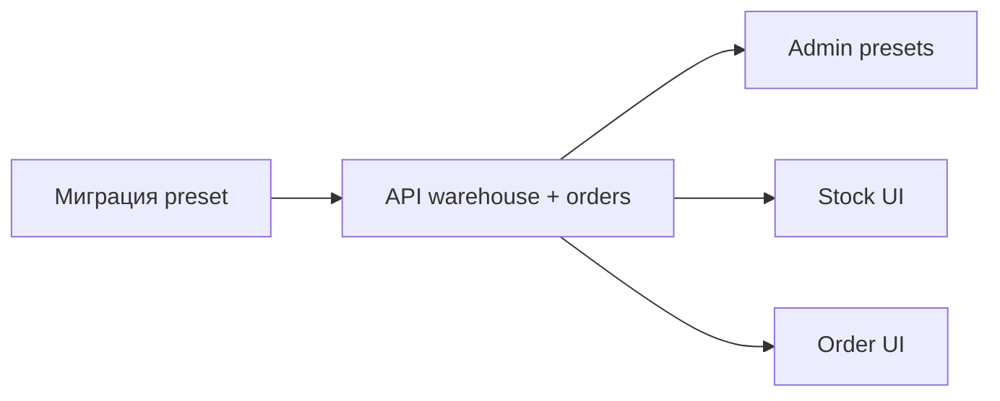

# Кабинет партнёра под макет Lead Mart — 18.11.2026

Бизнес прислал макеты кабинета партнёра (Lead Mart): склад, модалка покупки со склада, создание заказа на будущее. В scope этой итерации — **страницы лидов** (склад, заказы, связанные модалки), **без** Performance и Dashboard.

Макеты лежат в обсуждении (Buy Leads, Buy modal, Create Order).

## Экономика и settlement (17.11.2026)

Зафиксировано по обсуждению и реализации в коде (коммит **`c003c45`**, миграция `20261117.110000_0_default_add_settlement_wallet.php`). Детали терминов в `BUSINESS.md` и `PLAN.md`.

### Роли и цена сделки

| В Rider | Кто это |
| --- | --- |
| **Партнёр** (`partner`, кабинет `seller.<apex>`) | Покупает лиды, держит **кошелёк**, платит за продажу |
| **Байер** (`buyer`, `buyer.<apex>`) | Поставляет лиды, получает **нетто** после комиссии платформы |

**Catalog price** — сумма в центах на лиде/заказе (`priceCents`, payout per lead). Это то, что списывается с партнёра за один лид.  
Источник catalog сейчас: **цена заказа** (и floor из пресета при создании day-заказа — **убрать** в рамках этой итерации, см. ниже). После редизайна пресета catalog только из заказа / формы покупки со склада.

### Наценка платформы

В `BUSINESS.md` описаны **два** варианта (наценка сверху vs удержание из цены). В **коде заложено удержание из catalog**:

| При catalog = $100, markup 10% | Сумма |
| --- | --- |
| Партнёр (списание) | **$100** |
| Байер (зачисление) | **$90** (`buyerNetCents`) |
| Организация / платформа (fee) | **$10** (`platformFeeCents`) |

- Реализация: `OrganizationMarkup` → `Markup`, дефолт **10%**, override на организацию (`POST /organization/markup`).
- Округление fee: `intdiv(catalog * percent + 50, 100)`.

Вариант «партнёр платит catalog + 10%» в ledger **не** реализован — при смене бизнес-решения менять `Markup` и проводки.

### Когда двигаются деньги

| Момент | Что происходит |
| --- | --- |
| **Открытие заказа** (day или stock) | Проверка баланса: `volume × unitPrice` (`OrderDesk::open` → `assertPartnerCanAfford`). Списания **нет**, только sufficiency check. |
| **CPL — продажа лида (day/tomorrow)** | После матча в Kafka → async settle → **полный** CPL settle (см. ниже). В CH для CPL статус переводится в `delivered`. |
| **CPL — stock** | **Синхронно** в API при каждом лиде (`StockFulfillment` → `settleStockLead` → `settleCplDelivered`). |
| **CPA — продажа** | Партнёр **−catalog** сразу (`settleCpaSold`), байеру и платформе **пока ничего**. |
| **CPA — approve** | Байер **+net**, орг **+fee** (`LeadConversionDesk` → `settleCpaApproved`). Триггер: `POST /leads/{uuid}/approve` или постбек (позже). |
| **CPA — reject** | Байер/орг **не** получают; причина в `lead_conversion_notes`. **Возврат** партнёру за отклонённый CPA **не описан и не реализован**. |

#### CPL settle (один атомарный шаг)

Идемпотентность: `wallet_settlement_claims` по паре `(lead_uuid, kind)`:

1. Партнёр: debit `catalog` (`partner_lead_charge`).
2. Байер: credit `net` (`buyer_lead_credit`).
3. Организация: credit `fee` (`org_platform_fee`), если fee > 0.

#### CPA — два шага

1. `cpa_sold` — только charge партнёра.
2. `cpa_approved_payout` — payout байеру + fee оргу (только если был charge).

### Синхронно vs Kafka

| Путь лида | Settlement |
| --- | --- |
| **Stock order** | Синхронно в API |
| **Day / tomorrow** (matcher → `Sale::place`) | Matcher публикует envelope → consumer **`wallet:settle`** |
| **CPA approve** | Синхронно в API |

**Kafka**

- Топик: `RIDER_KAFKA_SETTLEMENT_TOPIC` (default `rider.lead.settlement`).
- Consumer group: `RIDER_KAFKA_SETTLEMENT_GROUP` (`rider-balance`).
- Envelope: `event: lead.settlement`, payload: `leadUuid`, `orderId`, `kind` (`cpl_delivered` \| `cpa_sold`), `catalogCents`, `partnerId`, `buyerId`, `organizationId`.
- Публикация: `Sale` после успешного match → `SettlementPublisher`.
- Обработка: `SettleLeadsCommand` + `SettlementAccumulator` — буфер до **200** сообщений или **~30 с**, затем `SettlementApply` → `SettlementDesk`.

Процесс в compose: сервис **`balance`** (`php yii wallet:settle`), обёртка `meta/projects/worker-rider-balance`.

Важно: **`supplied` на ордере** растёт сразу при матче; **баланс в UI** обновляется с задержкой batch — это не «деньги не сошлись», а отставание отображения (см. ниже).

### База и ledger

Миграция 17.11:

- `organizations.balance` — казна платформы по org.
- `users.balance` — кошелёк партнёра (уже был, используется в ledger).
- `wallet_transactions`: `kind`, `lead_uuid`, `order_id`, `metadata`; виды `partner_lead_charge`, `buyer_lead_credit`, `org_platform_fee`, `adjustment`.
- `wallet_settlement_claims` — идемпотентность settle.
- `lead_conversion_notes` — reject CPA с причиной.

Mock на dev: `POST /wallet/deposit`, `POST /wallet/withdraw` (+$100 по умолчанию).

### UI (на момент 17.11)

- Баланс партнёра в сайдбаре; Deposit / Withdraw.
- В карточке лида: **Approve / Reject** (CPA); CPL reject отклоняет API.
- Модалка покупки в макете (18.11): **wallet balance**, **insufficient balance**, total cost — опереться на тот же `assertPartnerCanAfford` и баланс из session.

### Известные долги / follow-up

| Тема | Статус |
| --- | --- |
| Обновление баланса в шапке после async settle | Session из `/session` не рефрешится; нужен polling или повторный `session.load()` |
| Возврат при CPA reject / отказе CPL | Не в scope 17.11 |
| Выбор «наценка сверху» vs «удержание» | В коде только удержание; подтвердить с бизнесом и синхронизировать `BUSINESS.md` |
| Цена из пресета при открытии заказа | Ещё есть `preset->priceFor()` — убрать в этой итерации (пресет без цены) |
| USDT, реальное пополнение | Mock deposit; провайдер не выбран |

### Деплой и env (стенд)

- В `api/.env`: `RIDER_KAFKA_SETTLEMENT_*`, `RIDER_REDIS_*` (`scripts/stage-ensure-env.sh`).
- Контейнер `rider-api-balance-1` рядом с matcher.
- Скрипты: `scripts/deploy-stage.sh`, `make deploy-stage`.

### Связь с редизайном кабинета (18.11)

- Макет Buy modal и Create Order: **payout × quantity** = total; проверка кошелька перед подтверждением — та же экономика, catalog = введённый payout.
- После удаления цен с пресета все settle-цепочки должны брать **только** `order.priceCents` / цену stock-запроса, без fallback на пресет.

## Согласовано с бизнесом

| Тема | Решение |
| --- | --- |
| Пресет | **Без цены** в каталоге. Два пресета на сегмент: **CPL** и **CPA** (модель на записи, не две цены на одной). |
| Цена | Задаёт **партнёр** при заказе и при покупке со склада (payout per lead). |
| Vertical | Новая **категория лида** (Gambling, Betting, Crypto, …) — в фильтрах склада и в формах. |
| Supplier | В Rider **нет** продавца в UI — колонку и карточку не показываем. |
| Склад | **Плоская таблица** офферов, без дерева country → traffic → age/gender. **Age/gender в UI склада не показываем** (матчинг в бэке — см. открытые вопросы). |
| Заказ на будущее | Близко к макету: vertical, GEO, model CPL/CPA, payout, date, quantity, daily cap. |

## Как сейчас в коде (от чего отталкиваемся)

- `Stock.vue` — дерево страна → traffic → age/gender, volume bars, «Buy all».
- `StockBuyDialog.vue` — volume, CPL/CPA, breakdown по листьям пресета.
- `OrderFormDialog.vue` — выбор пресета с ценой из каталога, model, volume, date, opens/closes.
- `Warehouse::inventory()` — строки по **lead gender**, в ответе age/gender и `cplPriceCents` / `cpaPriceCents`.
- `Preset` — country, traffic, age, gender, cr, **cplPriceCents**, **cpaPriceCents**.

## Целевое поведение (по макету)

### Страница склада (Buy Leads)

- Подзаголовок и фильтры: чипсы **vertical**, дропдауны GEO / vertical / traffic / model (и прочие из макета — по мере готовности API).
- Таблица: offer id, GEO+flag, vertical, traffic source, quantity, daily cap, conversion %, payout (не из пресета), updated, **Buy** (Make Offer / bulk buy — вне MVP, если не решено иначе).
- Пагинация и сортировка на клиенте допустимы на первом этапе.

### Модалка покупки со склада

- Карточка оффера: GEO, vertical, traffic, conversion.
- Quantity, available, daily cap, «today volume» (если есть данные из caps/orders).
- Payout (ввод партнёра) × quantity → **total cost**; **wallet balance** и insufficient balance + Add Funds.
- Confirm → существующий stock purchase с `paymentModel` пресета и **ценой из формы**.

### Create Order

- Поля: **Vertical**, **GEO**, **Model** (CPL/CPA), **Payout (per lead)**, **Date**, **Quantity**, **Daily cap**.
- Без привязки «цена из пресета»; `presetId` резолвится по vertical + geo + traffic (+ model) или выбирается из отфильтрованного списка.
- Текст на `Orders.vue` убрать про catalog price.

## Фаза 1 — Домен и API

### 1.1. Пресет

- Миграция: убрать `cplPriceCents` / `cpaPriceCents` из пресета.
- Поле `paymentModel`: `cpl` | `cpa` — **один пресет = одна модель**.
- Поле `vertical` (enum или справочник).
- Админка: создание **пары** пресетов (CPL + CPA) с одинаковыми критериями матчинга и разным `paymentModel`.

### 1.2. Цена и settlement

См. раздел **«Экономика и settlement (17.11.2026)»** — моменты CPL/CPA, Kafka, ledger уже в коде; меняем только **источник catalog** (без пресета).

- Цена только на **ордере** и в **запросе покупки со склада**; убрать fallback «цена из пресета» в `OrderDesk`, stock fulfillment, `Sale`, settlement.
- Регрессия: CPL/CPA settle, async `wallet:settle` для day-заказов, **синхронный** settle для stock.

### 1.3. Warehouse / stock API

Новый (или расширенный) контракт `inventory` под таблицу:

- `offerId` / `presetId`, `vertical`, `country`, `trafficSource`
- `conversion` (из `cr`)
- `available`, `dailyCap`, `updatedAt`
- **без** age, gender, supplier, цен пресета

Агрегация availability: сумма stock **по пресету** (все полы внутри критериев), если пресет остаётся узким сегментом в БД.

`dailyCap` — согласовать с текущей логикой caps / in-progress orders по организации и пресету.

### 1.4. Age / gender (решение перед кодом)

- **Вариант A (рекомендуется для MVP макета):** остаются в пресете/лиде для матчинга, **скрыты в партнёрском складе**; покупка идёт с полного пресета.
- **Вариант B:** убрать age/gender из пресета в каталоге (шире сегмент, больше работы matcher).

Зафиксировать выбор в `BUSINESS.md` или в этом файле перед реализацией.

### 1.5. Create Order API

Тело: vertical (или preset с vertical), geo, `paymentModel`, `payoutCents`, date, volume, daily cap, opens/closes при необходимости.

## Фаза 2 — UI партнёра

### 2.1. Оболочка (лёгкая)

- Заголовки и subtitle как в макете; при возможности — wallet в шапке, primary-стиль кнопок.
- Опционально: пункт меню Stock → «Buy Leads», routes без ломающих изменений.

### 2.2. Stock

- Заменить дерево на таблицу + фильтры.
- Подключить новый `inventory`.

### 2.3. StockBuyDialog

- Верстка под макет: wallet, insufficient balance, total cost.

### 2.4. OrderFormDialog + Orders

- Форма под макет Create Order; таблица заказов — status pill, conversion, payout по желанию.

### 2.5. Admin / Partner presets

- `Presets.vue`, `PartnerPresets.vue`: vertical, payment model, **без цены**; подсказка про пару CPL+CPA.
- Скрипт миграции данных: split старых пресетов с двумя ценами → два пресета + перенос ссылок в заказах.

## Фаза 3 — вне MVP (из макета)

- Supplier, online-статус, Make Offer, marketplace Offers.
- Bulk Buy, Demands, Wishlist, Reports.
- Полный клон sidebar Lead Mart.

## Порядок работ

```text
1. Миграция preset (vertical, paymentModel, без цены) + admin CRUD
2. Warehouse flat inventory + валидация stock buy (цена из запроса)
3. Order API + OrderFormDialog
4. Stock table + StockBuyDialog
5. Стили shell / копирайт
6. Миграция данных на стенде + smoke: stock buy, CPL/CPA order, settlement
```



## Открытые вопросы к бизнесу

1. Одна строка склада = **один пресет** (отдельные ряды для CPL и CPA на тот же GEO+traffic+vertical)?
2. Payout на stock buy: свободный ввод или фиксированный «оффер» (в макете похоже на фикс; у нас обсуждали ввод партнёра)?
3. Age/gender: **A** (скрыть в UI) или **B** (убрать из пресета)?
4. Нужны ли **bulk buy** и **Make Offer** в первой поставке?

## Оценка объёма

| Блок | Сложность |
| --- | --- |
| DB + preset split + migration | средняя |
| Warehouse aggregation | средняя |
| Order/stock price paths + settlement | средняя |
| Stock UI table + buy modal | высокая |
| Order modal | средняя |
| Admin presets | низкая |

## Связь с итерацией 16.11

Итерация 16.11 описывает роли, заказ, склад как пачку, дерево ротации в matcher. Эта итерация **не отменяет** matcher/организацию, но **меняет представление склада и пресета** для партнёра: плоский каталог, vertical, пресет без каталожной цены, два пресета CPL/CPA.